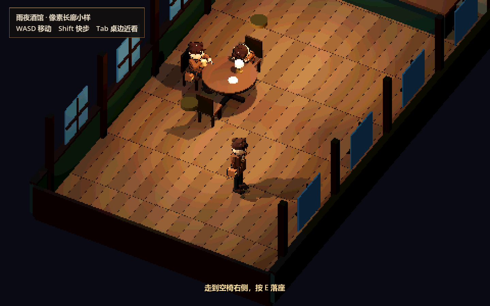
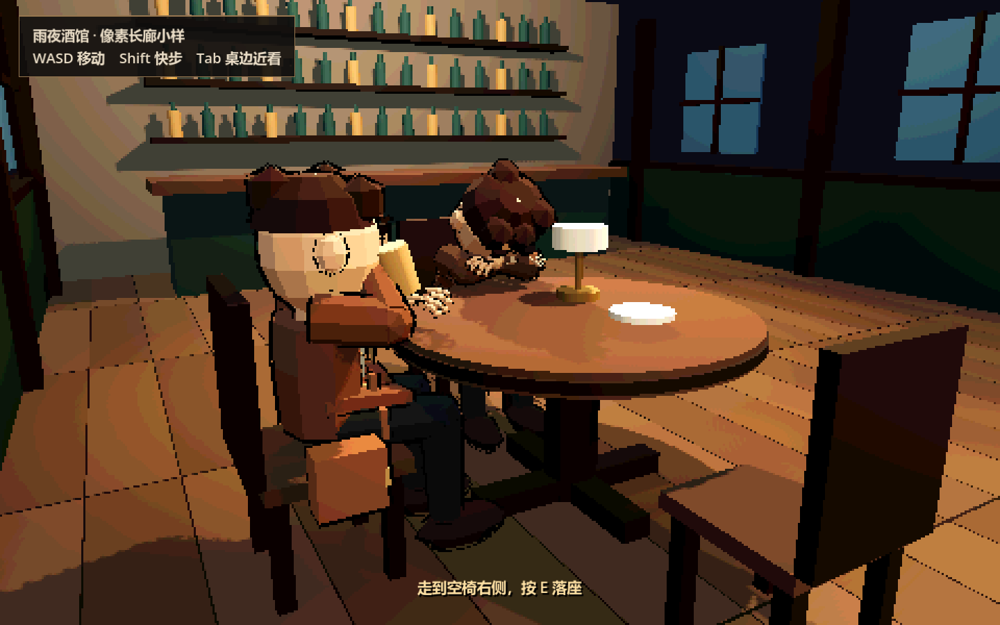
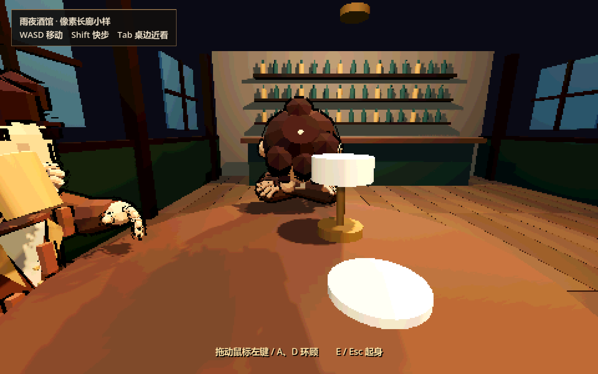

# 像素长廊空间小样 v1

2026-11-08。当前交付为一桌可玩的独立空间样片，用于确认“俯视像素 RPG 观感 + 实体 3D 身体与家具”的制作方向。未替换旧 F5 主流程，也未将 19 名角色全部制作成最终模型。

- 启动：[体验像素长廊小样.cmd](../../体验像素长廊小样.cmd)。Godot 4.7.2，Compatibility，Windows 键鼠。
- 工程：[corridor_3d.tscn](../../game/scenes/corridor_3d.tscn)。WASD 移动，Shift 快步，Tab 桌边近景，空椅右侧 E 落座，鼠标左键拖动或 A / D 环顾，E / Esc 起身。
- 可编辑源文件：[像素角色_接触动作.blend](像素角色_接触动作.blend)。Blender 5.2.1；独立生成的几何、材质和蒙皮，复用项目已有骨架与 idle / walk / seated 基础动作，增加 drink / sleep。未覆盖原始模型与角色动作源文件。
- 游戏模型：[patron_contact.glb](../../game/assets/tavern3d/patron_contact.glb)。三个人物暂复用同一简化棕衣角色，后续角色身份和正式服饰仍需分别制作。

## 实际画面

这些是 Godot 实际运行截图。场景按三分之一分辨率渲染后采用 nearest 放大，叠加有限色阶与人物轮廓；界面文字独立保持清晰。身体仍使用立体网格、骨骼与碰撞，不是立在场景中的人物图片。

## 接触与验证

- 圆桌高 0.84 m、半径 0.78 m，椅面高 0.48 m；坐姿、折臂与持杯动作按这些尺寸制作。衣摆分开跟随腿部，肩包外移，避免原写实模型的大块拉扯。
- 酒杯挂在 `RightHandGrip` 骨骼挂点，杯柄与右手姿态共同校准。起身恢复落座前的可站立位置与碰撞。
- `corridor_regression.gd`：50 项检查、0 失败；包括真实移动输入、桌/椅/墙/NPC 阻挡、走廊通行、禁止隔桌落座、反复落座/返回、25 个时刻的杯子跟手关系及像素渲染配置。
- 变形后人物网格检查：举杯 121 帧、趴桌静态姿势 1 次；桌板体积内顶点数为 0。检查容差 2 mm，详细结果见 [contact_authoring.json](../../game/assets/tavern3d/contact_authoring.json)。此项覆盖桌板，不代表已证明所有网格之间在任意动作、任意机位下都完全无穿插。
- 有窗口检查了俯视、举杯前后、趴桌侧面与第一人称。1440×900 截图的世界区域抽查 63,000 个 3×3 像素块，块内颜色一致，未发生模糊插值。
- 原主流程 `playtest.gd` 本次回归通过，未改变原探索与剧情规则。

## 复现

用 Blender 5.2.1 后台执行 `tools/build_tavern_contact_sample.py`；它调用 `tools/pixel_rpg_body.py` 生成简化身体并导出动作。脚本若检测到桌板穿插将停止导出。Godot 导入后执行 `res://tests/corridor_regression.gd`，画面记录使用 `res://tests/corridor_render.gd`。

运行日志和原始截图位于被 Git 忽略的 `game/verification/`；本目录保存选定的预览和源文件。当前重点是视角、像素观感与空间接触，场景摆件和人物造型仍是小样品质。
