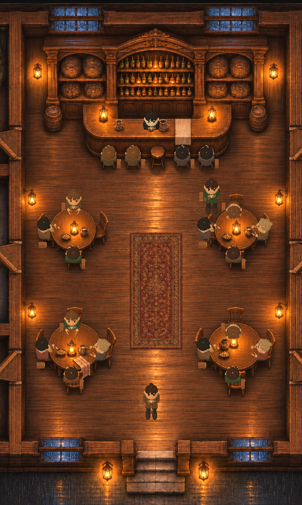

# 原酒馆 · 满座与 NPC v1

2026-11-08。此版本接入 F5 / 根目录 `开始试玩.cmd` 主流程，使用用户确认的原酒馆图片；先前独立的一桌 3D 小样不再作为正式酒馆的场景方向。

- 房间、四张圆桌、吧台、地毯、雨窗和暖光保持原图。对比用户附件与 `game/assets/environment/tavern.png` 解码后的 RGB，1620×971×3 像素完全相同。
- 四桌坐 15 位酒客（3 / 4 / 4 / 4），上方左桌右侧留给玩家。吧台坐 4 位客人，另有酒保、绿衣同伴和主角，共 22 个人物实例。酒客有服饰、发色、坐姿、举杯和趴桌变体；当前仍共用简化身体，并非 22 个最终独立角色模型。
- 人物由独立 `SubViewport` 中的真实网格与骨骼实时渲染并投影到原图上，不是场景里的平面人物卡。家具深度代理负责遮住身体，原图负责家具外观；主角继续使用已存在的 2D 移动和交互控制器。4 个桌面投影与底图中心误差均低于 0.3 px。
- 主角碰撞避让范围加入外套、肩包余量，同伴占地同步扩大。吧台→同伴路线改从同伴左侧接近，测试直接检查能否出现实际交谈目标。
- 本次 `tavern_crowd_regression.gd`：88 项检查、0 失败，覆盖人数、空座、骨架、杯子挂点、独立 3D 世界、桌面及脚底投影；主流程 `playtest.gd`：47 项通过、0 失败，包含行走、对话、落座、返回和重开。
- 已查看主流程实机的入口、吧台、对白、落座及不同窗口尺寸。当前检查不能替代对全部服饰边缘、动画中间帧和所有移动方向的最终人工验收。

实现位于 `game/scripts/tavern_people_3d.gd`、`game/scripts/map_head_pose.gd` 和 `game/scripts/tavern.gd`；全图截图由 `game/tests/tavern_crowd_render.gd` 从实际场景渲染，没有改绘底图。
